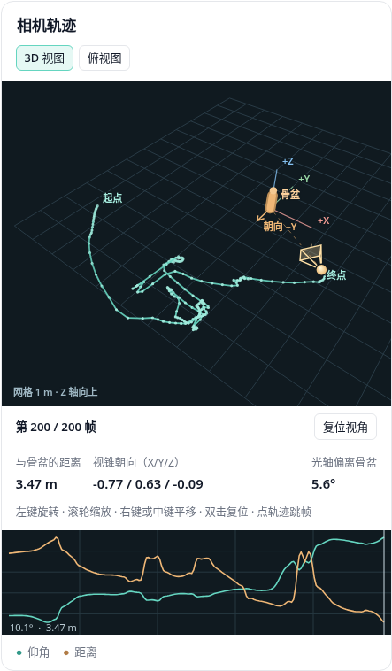
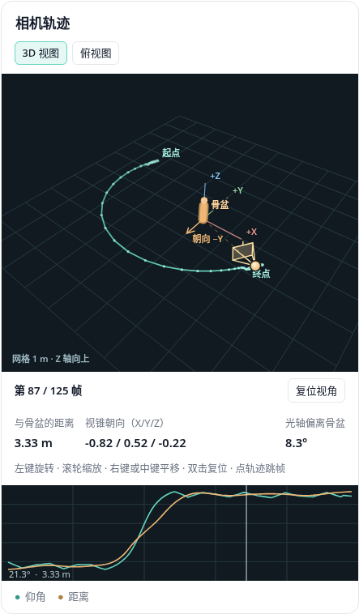

# Camera Trajectory

[简体中文](README.zh.md)

Recover an animated, subject-relative camera from a monocular video or a calibrated PNG sequence. The workbench runs OpenCV and the bundled weights locally. The latest stable Blender 5.3 release is the default and the acceptance-test version. Blender 4.2 and 4.5 LTS are also supported.

## Install and run

1. Extract the plugin tarball or run `npm ci` and `npm run build:desks` in this repository. Install the resulting package directory with `penguin plugin install /absolute/path/to/package`. In the target Agent’s Plugins settings, install Camera Trajectory from the library to add its App Center shortcut.
2. Open the workbench in App Center and review **Environment check**. The server uses `PENGUIN_CAMERA_PYTHON` when set. Otherwise it checks `python` first on Windows and `python3` first elsewhere. Python 3.10 or newer is supported. If `numpy` or `cv2` is missing, or OpenCV is older than 4.10, select **Set up environment** once. The server creates a project virtual environment, prefers `uv` when available, and activates the interpreter after verifying both imports. Internet access is used during dependency installation. Local tracking runs offline.
3. To download `.blend` files, install Blender 5.3 on the server. The service looks for `blender-5.3` on `PATH`, then `blender`. On Windows it checks the standard Blender 5.3, 4.5 and 4.2 Program Files locations before `PATH`. Set `PENGUIN_CAMERA_BLENDER` to the absolute path of the executable to override discovery, and restart the service after changing its environment. Select **Check again** once Blender is available. To use Blender 4.2 or 4.5 LTS, export from the same trajectory JSON with that version.

Open Camera Trajectory in App Center and choose a video or a PNG sequence. MP4, MOV and WebM files can be up to 48 MiB. For a PNG sequence, provide `intrinsics.json` and choose calibrated dynamic rotation, the legacy calibrated comparison, or movie tracking. Frames are ordered by filename, and the sequence can be up to 1 GiB. Either input can contain up to 3,000 frames. Set the estimated subject height and select Build .blend if needed. **Track video** runs locally and works offline. **Run with Agent** uses the Project’s default model to call the local tools and streams the Agent’s progress. The model receives the task instructions and file paths.

Review the video or use the sequence scrubber, then check the top view, elevation curve and diagnostics after tracking. Download the generated `.blend`, or save the JSON and Blender script side by side and run the script in Blender’s Scripting workspace.

Expand **Optimization history** to view each round's hypothesis, score, decision, and the frozen holdout result. [Round data](docs/evolution.json)

### Explore the 3D path

The workbench opens in **3D view** with a meter grid. The gold capsule marks the pelvis origin and its arrow points forward along −Y. The turquoise path and dots represent the recovered frames. The gold marker and frustum show the current frame. The **Frustum direction** is the camera’s unit forward vector in pelvis coordinates (X/Y/Z). The **Off-axis angle to pelvis** approaches 0° when the camera points toward the pelvis.

Drag with the left mouse button to orbit, use the wheel to zoom, and drag with the right or middle button to pan. Double-click or select **Reset view** to fit the path again. Click a path point to seek to its frame. Video playback and the sequence scrubber update the marker and the distance/elevation curves. Select **Top view** for the original 2D plot.

| La La Land pier, 5.81 m → 3.47 m | Fast orbit, about 161° |
|---|---|
|  |  |
| [Before the push in](docs/trajectory-3d-lalaland-far.png) | [Before the orbit](docs/trajectory-3d-orbit-start.png) |

For command-line use, use the interpreter shown by **Environment check** or install `tools/requirements.txt` into a separate virtual environment.

```bash
CUDA_VISIBLE_DEVICES="" python tools/track.py \
  --images /path/images --intrinsics /path/intrinsics.json --out /path/trajectory.json
python tools/verify_trajectory.py /path/trajectory.json
blender -b --python-exit-code 1 -P tools/blender_export.py -- \
  --trajectory /path/trajectory.json --blend /path/camera.blend
```

To track a video, use `--video /path/shot.mp4`. Intrinsics can be supplied for either input and use image dimensions, `fx/fy/cx/cy`, and `fps`. The output is a metric camera-to-subject transform with unit `wxyz` quaternions, Blender Z-up and camera -Z forward.

Calibrated input defaults to `views-review`, which combines body landmarks and full background rotation. A dynamic head and chest target provides a weak orientation constraint, while ground geometry and foot contact help recover metric scale. Uncalibrated video defaults to `movie`. The landmark model was trained on procedural characters. The calibrated image path assumes a 1.65 m subject by default. Adjust it with `--subject-height`.

The CPU-only container also runs with networking disabled after the build:

```bash
docker build -t camera-trajectory-cpu tools
docker run --rm --network none -v /path/job:/job camera-trajectory-cpu \
  --images /job/images --intrinsics /job/intrinsics.json --out /job/trajectory.json
```

## Measurements

The frozen candidate was evaluated once on holdout v3. Both entry points used the same 20 synthetic clips (2,500 frames per path), one CPU core and single-threaded OpenCV.

| Entry point | Clips | ATE cm | RotErr ° | RPE | CPU ms/frame |
| --- | ---: | ---: | ---: | ---: | ---: |
| Formal benchmark · PNG + intrinsics (`views-review`) | 20 | 31.37 | 5.81 | 4.63 | 7.66 |
| Convenience input · uncalibrated MP4 (`movie`) | 20 | 40.03 | 7.34 | 6.37 | 7.56 |

The formal PNG path meets the rotation and runtime targets (10° and 20 ms/frame). Its ATE exceeds the 20 cm target. The video path works without lens calibration and is suitable for previews from existing footage. Its ATE and RotErr on the same clips were 8.65 cm and 1.53° higher. Prefer PNG frames and measured intrinsics for metric comparisons.

[Formal-path breakdown by case (Chinese)](https://github.com/Prism-Shadow/penguin-harness-apps/blob/feat/camera-trajectory/plugins/camera-trajectory/docs/holdout-v3-diagnosis.md)

## Limitations

- **Simultaneous camera and subject motion.** The two holdout clips had absolute position RMSE of 66.57–144.00 cm with calibrated input and 74.20–319.08 cm with video. When the subject changes pose or the ground cannot be tracked reliably, camera motion and subject motion become hard to disentangle. Prefer the calibrated sequence, keep stable ground features in view, and verify the metric trajectory before using it for a shot.
- **Full occlusion.** Both paths recorded 0 false-visible frames out of 179 on v3. An earlier v2 wide-pillar case sent both clips to the general video backend, which recorded 15/124 false-visible frames (12.10%). The trajectory can lose subject confidence or drift while the body is hidden. Keep clear frames on both sides of the occlusion and check the interpolated segment before export.
- The landmark model was trained on procedural characters. The film review checks shot motion and composition.

[Historical source and Blender proxy comparisons](docs/film-preview.jpg)
