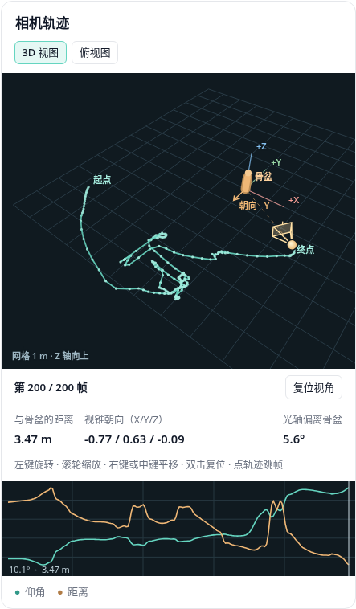
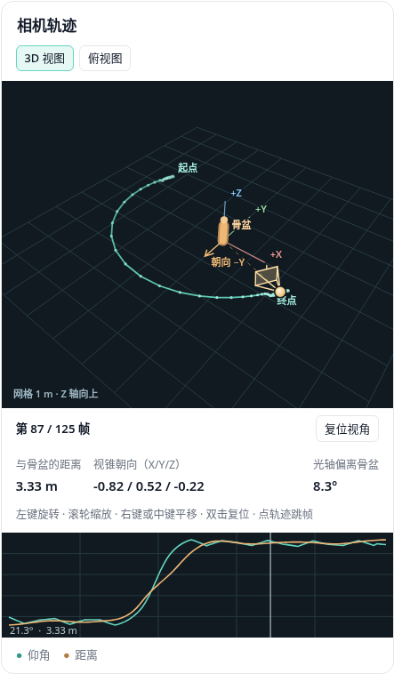

# 相机轨迹反求

[English](README.md)

将单目视频或 PNG 序列变成 Blender 相机动画。默认与验收使用最新正式版 Blender 5.3，兼容 4.2 和 4.5 LTS。工作台默认在本地用 CPU 和包内权重处理视频，也可交给项目配置的 Agent 调用本地工具。

## 安装

1. 从插件 tarball 解压，或在本仓库用 Node 24 执行 `npm ci` 和 `npm run build:desks`，得到 `plugins/camera-trajectory`。使用 `penguin plugin install /absolute/path/to/package` 将解压目录或源码包目录注册到 PenguinHarness 的插件库。在目标 Agent 的「插件」中从插件库安装相机轨迹反求，应用中心随后显示工作台。
2. 在应用中心打开工作台，查看「环境自检」。服务端优先使用 `PENGUIN_CAMERA_PYTHON`。默认在 Windows 查找 `python` 再找 `python3`，其他平台顺序相反。支持 Python 3.10 或更高版本。缺少 `numpy` 或 `cv2`，或 OpenCV 低于 4.10 时，点「一键准备环境」。这一步只做一次，只在装依赖时联网。服务端建立该项目的虚拟环境，优先用 `uv`，没有时用 `pip`。通过导入检查后自动保存并启用解释器路径。
3. 如需直接下载 `.blend`，在服务端安装 Blender 5.3。Linux 等平台从服务端 `PATH` 先查找 `blender-5.3`，再查找 `blender`。Windows 依次检查 Program Files 下 Blender 5.3、4.5、4.2 的官方安装目录，再查询 `PATH`。可用 `PENGUIN_CAMERA_BLENDER` 指定可执行文件的绝对路径，修改服务端环境后需重启服务。安装后点「重新检查」。如需在 4.2 或 4.5 LTS 中使用，可用对应版本从同一份轨迹 JSON 导出。

## 使用

打开应用中心中的「相机轨迹反求」，选择「视频」或「PNG 序列 + 内参」。视频支持 MP4、MOV、WebM，上传上限 48 MiB。PNG 序列按文件名的数字顺序处理，需上传 `intrinsics.json`，总上限 1 GiB。两种输入最多 3,000 帧。序列可选「标定 · 动态朝向」「标定 · 历史对照」或「电影跟踪」。填写主体身高，按需勾选「生成 .blend」。

- 点击「反求轨迹」可离线直跑。
- 点击「交给 Agent 运行」会调用项目默认模型。工作台显示 Agent 回复和工具进度，跟踪和导出在宿主本机执行。模型接收任务指令和文件路径。

任务完成后可播放视频或拖动序列帧进度条、点击曲线选时，检查俯视轨迹、背景残差和主体覆盖，再下载轨迹 JSON、Blender 脚本和已生成的 `.blend`。执行脚本时将 `trajectory.json` 放在 `build_camera_in_blender.py` 旁边。[Agent 指令模板](skills/camera-trajectory/SKILL.md)

在工作台底部展开「优化记录」，可查看各轮假设、候选、得分、淘汰结果及冻结留出验收。[原始轮次数据](docs/evolution.json)

### 查看 3D 轨迹

默认打开「3D 视图」，地面网格以米为单位。金色胶囊标出骨盆原点，箭头沿人物前方 −Y。蓝绿色折线和小点表示各帧，金色高亮球与视锥表示当前帧。视锥使用 Blender 相机的四元数，朝向显示为骨盆坐标系内的 X/Y/Z 单位向量。「光轴偏离骨盆」越接近 0°，镜头越朝向骨盆。

左键拖动旋转，滚轮缩放，右键或中键拖动平移。双击画布或点「复位视角」可重新取景。视频或序列进度改变时，3D 高亮和距离／仰角曲线同步。点 3D 轨迹的小点可跳到对应帧。「俯视图」可切换回原 2D 视图。

| 《La La Land》栈桥，5.81 m → 3.47 m | 快速环绕，约 161° |
|---|---|
|  |  |
| [对照推近前](docs/trajectory-3d-lalaland-far.png) | [对照环绕前](docs/trajectory-3d-orbit-start.png) |

### 命令行

命令行运行可复用自检中显示的解释器，或在独立虚拟环境用 `python -m pip install -r tools/requirements.txt` 安装两个依赖。`cv2` 由 `opencv-python-headless` 提供。

```bash
CUDA_VISIBLE_DEVICES="" python tools/track.py \
  --images /path/images --intrinsics /path/intrinsics.json --out /path/trajectory.json
python tools/verify_trajectory.py /path/trajectory.json
blender -b --python-exit-code 1 -P tools/blender_export.py -- \
  --trajectory /path/trajectory.json --blend /path/camera.blend
```

视频输入使用 `--video /path/shot.mp4`，可与 `--intrinsics` 同用。内参包括像素尺寸、`fx/fy/cx/cy` 和 `fps`。逐帧输出米制平移和 `wxyz` 单位四元数，使用 Blender Z 向上、相机局部 -Z 朝前、人物根节点为原点的坐标约定。

标定输入默认使用 `views-review`，结合人体地标与背景的完整旋转估计朝向，以动态头胸目标作弱约束。地面几何和足部接触提供米制尺度证据。无内参视频默认使用 `movie`。地标模型在程序化人形上训练。标定帧的默认身高为 1.65 m，可用 `--subject-height` 覆盖。

CPU 容器可在构建完成后断网运行：

```bash
docker build -t camera-trajectory-cpu tools
docker run --rm --network none -v /path/job:/job camera-trajectory-cpu \
  --images /job/images --intrinsics /job/intrinsics.json --out /job/trajectory.json
```

## 指标

现行验收使用 holdout-v4。冻结版只评一次，两个入口使用同一组 40 段、各 5,000 帧，单逻辑核、OpenCV 单线程。

| 入口 | 段数 | ATE cm | RotErr ° | RPE | CPU ms/帧 |
| --- | ---: | ---: | ---: | ---: | ---: |
| 正式入口 · PNG + 内参 (`views-review`) | 40 | 35.88 | 6.31 | 5.56 | 7.65 |
| 视频入口 · 无内参 MP4 (`movie`) | 40 | 57.58 | 8.37 | 8.02 | 7.22 |

正式入口的旋转与耗时达标，ATE 超出 20 cm。 视频入口用于从无内参的现有片段预览运镜。[逐类结果](https://github.com/Prism-Shadow/penguin-harness-apps/blob/feat/camera-trajectory/plugins/camera-trajectory/docs/holdout-v4-results.md)

## 局限

位姿和权重沿用上一发布版。五帧航向融合、短遮挡桥接与重拟合平移头在开发折上未带来稳定收益。

- **同动与快速转向。** 本轮训练组合暴露了开场就存在的方位偏差。v4 四段同动未对齐位置 RMSE 均值为正式入口 129.38 cm、视频入口 198.19 cm。需要米制位置时优先使用标定帧序列，保留可追踪背景并核对轨迹。
- **遮挡。** v4 完全遮挡误报分别为 0/230（0.00%）、5/230（2.17%）。主体消失时几何和已观测位姿只能提供有限约束。导出前查看遮挡区间与两侧的轨迹。
- **数据覆盖。** `038-target-and-camera-alpha` 中有 27 帧相机低于地面。主表保留预先封存的全部片段。本轮配比覆盖七类，低纹理、单独裁切和强透视缺少独立类别。

[原片与 Blender 代理的历史对照](docs/film-preview.jpg)
